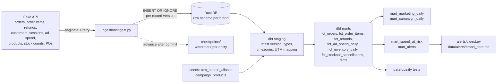

# Marketing Data Reliability Pipeline

**For every dollar an online store spends on ads, how much real money comes back, and is it being spent on products that are about to sell out?**

**The problem.** Ad platforms each take credit for the same sale, so their numbers add up to more than the store actually made. And ads keep running on a product after it sells out: customers keep ordering it, and then those orders get cancelled.

**What it does.** It pulls a store's ad spend, orders, refunds and stock levels, cleans them up, and works out how much revenue each ad dollar really brought back. It warns when ads are paying to promote a product that's about to run out. A built-in assistant answers questions about the numbers in plain English.

**Results.**
- **The warning comes early.** In the test data it flagged one brand's best-selling product, a serum, 18 days before it sold out. The ads kept running anyway: an estimated $1,600 went on advertising it after there was none left to sell.
- **A sell-out costs more than the missing product.** When an order is cancelled, everything else in the cart goes with it. The first version missed this: $347 of other products for one brand and $1,661 for the other. Writing the assistant's test questions exposed the gap, and it's now measured.
- **The assistant's first test was too easy.** It got 10 out of 10 right, both with and without written definitions of the business terms, so the test couldn't show whether the definitions help. Four harder questions have been added since but not yet run against the live AI.

**How it's kept safe.** Three separate layers, so no single check is trusted alone: the assistant can only read the data, never change it; every query it writes is checked before it runs; and it sees one brand at a time, chosen by the person using it, not by the AI. When it can't answer safely, it gives a fixed, pre-written reply or asks a clarifying question instead of guessing.

> This project runs on **synthetic data** served by a **fake paginated API** (`source/`). It's not a live Shopify or ad-platform integration. The fake API behaves like the real ones in the ways that matter here: it paginates, rate-limits, fails intermittently, repeats records, delivers some data late, and restates spend after the fact.

## What it computes

The pipeline ingests daily ad spend from Meta and Google alongside the store's own orders and refunds, cleans up inconsistent campaign and UTM naming, and reconciles spend against the revenue the store actually kept. The outputs are MER, ROAS, AOV and new-customer CAC that can be trusted.

It then asks the follow-up question that ROAS can't answer: **are we spending that money on something we're about to run out of?** Stock counts, line items and purchase orders feed a spend-at-risk mart and an alert digest, so a campaign burning budget on a SKU with four days of cover shows up before the stockout, not after. The analytics agent, its guardrails and its evals are described [below](#analytics-agent).

## Why this is harder than it looks

- **Platforms over-claim.** Meta and Google each take credit for the same sale, so summing platform-reported revenue overstates it. In the demo data, platform-reported revenue is higher than the store's total revenue.
- **Tagging is done by hand.** One brand ends up with `facebook`, `FB`, ` Facebook `, `fb.com` and `IG` all meaning the same platform, plus blank and missing UTMs.
- **Numbers change after the fact.** Refunds arrive weeks later, ad platforms restate spend for a few days, and some records reach the API late.
- **Days don't line up.** Orders are timestamped in UTC, while ad platforms report in the account's local day.

## Architecture



Data flows from synthetic ad and order APIs into raw DuckDB tables, then through dbt staging and marts for reporting and quality checks.

Every brand is a separate tenant: `raw_<brand>`, `<brand>_staging` and `<brand>_marts` in one DuckDB file, with dbt run once per brand.

## Project structure

```
config.py                 brands, entities, page size, retry and lookback settings
run_pipeline.py           runs ingestion + dbt + the digest; --demo replays three runs from scratch
source/
  generate.py             synthetic orders, line items, stock, POs and ad spend (with realistic mess)
  fake_api.py             paginated, unreliable API over the synthetic data
ingestion/
  ingest.py               pagination, retries, idempotent raw loads, checkpoints
transform/                dbt project (DuckDB)
  seeds/                  utm_source_aliases.csv (source name mapping)
                          campaign_products.csv (which SKUs each campaign promotes)
  macros/                 latest_version, clean_text, per-tenant schema naming
  models/staging/         one model per source entity
  models/marts/           facts, dimensions, the reporting marts, spend-at-risk and alerts
  tests/                  business-rule tests (reconciliation, unmapped revenue, ...)
alerts/
  digest.py               turns mart_alerts into a Markdown note per brand per day
agent/                    a CLI agent that answers questions over one brand's marts (see below)
  loop.py                 the agent loop and system prompt
  tools.py                list_tables, run_query, get_data_health, and the SQL guardrails
  fallbacks.py            deterministic fallbacks: fixed explanations, clarifying questions and reports
evals/                    questions with SQL-computed answers, and a script that scores the agent
tests/                    pytest suite for ingestion, the stockout scenario, and the agent's guardrails
```

## Running it

Requires Python 3.11+.

```bash
python -m venv .venv && source .venv/bin/activate
pip install -r requirements.txt

python run_pipeline.py --demo   # wipe data/, generate, three incremental runs, idempotency check
python -m pytest                # 83 tests: ingestion, the stockout scenario, the agent (no API key needed)
```

The demo takes three or four minutes (nine entities, three runs, two brands), ends with a summary per brand, and writes an alert digest to `data/alerts/`. After that:

```bash
python run_pipeline.py                                      # pick up anything new, rebuild marts
python -m ingestion.ingest --as-of 2026-08-15T00:00:00Z     # ingestion only, as of a point in time
python -m alerts.digest                                     # rewrite the digests from the marts
dbt build --project-dir transform --profiles-dir transform \
  --vars '{brand: acme_apparel, reporting_tz: America/New_York}'
```

Run commands from the repository root. The warehouse is `data/warehouse.duckdb`, and you can open it with the `duckdb` CLI or Python to explore the marts.

## Metrics

| Metric | Definition | Where |
|---|---|---|
| Spend | Current (restated) ad spend | both marts |
| Gross revenue | Subtotal − discounts, excluding tax and shipping | both marts |
| Net revenue | Gross revenue − refunds, with refunds dated to the **original order** | both marts |
| AOV | Gross revenue ÷ orders | `mart_marketing_daily` |
| MER | Net revenue ÷ total spend (blended). **The headline number** | `mart_marketing_daily` |
| New-customer CAC | Total spend ÷ customers placing their first order | `mart_marketing_daily` |
| ROAS | Last-click attributed net revenue ÷ campaign spend | `mart_campaign_daily` |
| CPA, conversion rate | Spend ÷ attributed orders; attributed orders ÷ clicks | `mart_campaign_daily` |
| Platform-reported ROAS | What Meta/Google claim, kept alongside for comparison only | `mart_campaign_daily` |

Every ratio returns NULL rather than 0 when its denominator is zero. A day with no spend has no MER; it doesn't have an MER of 0.

## Inventory-aware spend and alerts

Ad spend and stock are the same problem. A campaign performs, so it keeps spending, but the SKU it promotes is about to sell out. Orders still arrive, they go on backorder, and two weeks later a chunk of those customers cancel. You paid for clicks that turned into refunds, and per-campaign ROAS looked fine the whole time, because the revenue was booked before the cancellation.

This half of the pipeline answers one question: *which campaign is spending money on something we're about to run out of?* It answers it before the stockout rather than after.

### The metrics

| Metric | Definition | Where |
|---|---|---|
| Units sold | Units ordered per SKU per day, including units that went on backorder | `fct_inventory_daily` |
| On hand | Units in the warehouse at close of business | `fct_inventory_daily` |
| Velocity (14d) | Trailing average units sold per day, ending the day before | `fct_inventory_daily` |
| Days of cover | On hand ÷ velocity. NULL when velocity is 0 | `fct_inventory_daily` |
| Projected stockout date | Snapshot date + days of cover | `fct_inventory_daily` |
| Open PO units, next restock | Units on POs not yet received, and the earliest promised arrival | `fct_inventory_daily` |
| Reorder point | Velocity × (supplier lead time + `safety_days`) | `fct_inventory_daily` |
| Spend at risk | Campaign spend allocated to a SKU on a day that SKU is exposed | `mart_spend_at_risk` |
| Lost revenue (per SKU) | Line revenue of the at-risk SKU itself on orders cancelled with reason `out_of_stock`, on days a campaign spent on it | `mart_spend_at_risk` |
| Lost revenue (per order) | Every line of an order cancelled with reason `out_of_stock`, split into out-of-stock items and in-stock items lost with them | `fct_stockout_cancellations` |
| Estimated ad cost of a cancelled order | The campaign's spend ÷ attributed orders for that month. An estimate; overlaps spend at risk | `fct_stockout_cancellations` |

Campaign spend is split evenly across the SKUs a campaign promotes (`seeds/campaign_products.csv`), and a SKU's lost revenue is split the same way across the campaigns promoting it, so summing either column gives that SKU's total without double counting. It does not give the total cost of the stockout, which is what `fct_stockout_cancellations` is for.

**A stockout loses the whole basket.** When a backordered order is cancelled, the entire order is refunded, including items that were in stock. `mart_spend_at_risk` is keyed by campaign × SKU × day, so it only sees the out-of-stock SKU's own lines. `fct_stockout_cancellations` has one row per cancelled order and splits the loss:

| | acme_apparel | bloom_skin |
|---|---|---|
| Orders cancelled `out_of_stock` | 22 | 18 |
| Lost revenue, out-of-stock items | $1,297.70 | $1,764.60 |
| Lost revenue, in-stock items in the same orders | $1,661.20 | $347.10 |
| **Lost revenue, total** | **$2,958.90** | **$2,111.70** |
| Estimated ad cost of those orders | $1,310.55 | $1,230.30 |

The ad cost is an estimate. Spend is reported per campaign per day, not per order or product, so each cancelled order is charged its campaign's average cost per attributed order that month, and orders with no campaign are charged nothing. It overlaps `spend_at_risk` (both include some of the same campaign dollars), so the two are never added together. They answer different questions: money spent advertising a product with no stock, and money spent winning orders that were then cancelled.

This gap turned up while writing ground-truth SQL for the analytics agent's evals (below): the sum of `mart_spend_at_risk.lost_revenue_out_of_stock` didn't match the total of out-of-stock cancellations.

### The alert rules

| Alert | Fires when | Threshold | Severity |
|---|---|---|---|
| `stockout_risk_with_active_spend` | The SKU still has stock, the campaign is spending on it, and it runs out before the next delivery | cover shorter than the wait for the next restock; or cover ≤ `stockout_alert_days` (7) when nothing is due | high under 3 days of cover, else medium |
| `spend_on_out_of_stock_sku` | On hand is 0 and the campaign still spent on it that day | any spend | high |
| `mer_drop` | 3-day MER is below its 14-day baseline | `mer_drop_threshold` 25%, needs ≥ 10 orders that day | high at 50%, else medium |
| `cac_spike` | 3-day new-customer CAC is above its 14-day baseline | `cac_spike_threshold` 35%, needs ≥ 5 new customers | high at 70%, else medium |

Thresholds are dbt vars in `transform/dbt_project.yml`, so tuning them is one edit rather than a hunt through SQL.

Two decisions worth explaining:

**The observed side is smoothed; only the baseline is long.** A single day's MER on twenty orders swings by a third on its own. Comparing one noisy day against a smooth 14-day baseline fires constantly, and an alerting layer that cries wolf gets muted within a week. So each rule compares a 3-day average against the trailing baseline, and each has a minimum-volume guard. On the demo data the smoothing takes `acme_apparel` from 14 MER alerts over two months down to 4.

**A promised delivery date that has already passed is not a delivery.** A PO stays open when the supplier misses its date, so `next_restock_date` can be in the past. `mart_spend_at_risk` only counts a restock that is still in the future, which means an overdue PO makes the SKU look unprotected, because it is.

### The push step

`alerts/digest.py` runs at the end of every pipeline run: it reads the most recent date in `mart_alerts` per brand, writes `data/alerts/<brand>_<date>.md`, and prints the most severe alerts. It uses the latest date in the data rather than the wall clock, because the synthetic sources stop at the end of August.

Slack and email delivery are deliberately not built. They need a credential, a retry policy and a deduplication rule of their own, and the part worth showing is here: deciding what is worth saying.

### The scenario in the demo data

Each brand's data contains one deliberate failure, so the alerts have something real to catch:

| | acme_apparel | bloom_skin |
|---|---|---|
| Hero SKU | `TEE-BLK-M` | `SERUM-VITC-30` |
| Campaign that keeps spending | Summer_Sale, ~$314/day | Summer_Sale, ~$307/day |
| Out of stock | Aug 13 – Aug 27 | Aug 12 – Aug 27 |
| Replacement PO | promised Aug 24, arrived Aug 28 | promised Aug 24, arrived Aug 28 |
| Backordered orders | 64 | 73 |
| Cancelled `out_of_stock` | 22 orders, $2,959 | 18 orders, $2,112 |
| **Predictive alert fires** | **Aug 3, 10 days early** | **Jul 25, 18 days early** |
| Spend exposed while at risk | $2,652 | $3,498 |

### Assumptions

- **One location.** On-hand is a single number per SKU per day. No warehouses, transfers or store stock.
- **Velocity is a trailing average**, not a forecast. It doesn't know about seasonality, a planned promotion or a pending price change. Anything beyond a trailing average is forecasting, which is a different project.
- **Lead times are fixed per SKU**, taken from the product record. Real suppliers vary, and the demo data shows exactly that: the promised date is a field, and the arrival is a fact that can disagree with it.
- **Campaign spend is split evenly across promoted SKUs.** A real ad account can give spend per ad or per product; this source can't.
- **The campaign → SKU mapping is maintained by hand.** A test fails the build when it points at a SKU that doesn't exist, and warns when a campaign with spend has no mapping at all.
- **A backordered order that is cancelled is a full refund**, dated to the original order like every other refund.

## Design decisions

**Internal orders are the source of truth for revenue.** Platform conversions are stored in separate `platform_reported_*` columns and never added to revenue. MER is the number to steer by because both sides of it are complete and deduplicated. Per-campaign ROAS is useful for comparing campaigns with each other, but it's directional: last-click can't see view-through or cross-device conversions.

**Raw is append-only and keyed on version.** Each raw row is one version of one record, with primary key `(id, updated_at)`. Loading the same version twice is a no-op (`INSERT OR IGNORE`), and a corrected record lands as a new row. Raw is never updated, so every downstream model can be rebuilt from it. Staging picks the latest version per id.

**Incremental ingestion with a watermark and a lookback.** Each brand × entity has a checkpoint holding the highest `updated_at` loaded. The next run requests `updated_at >= watermark − lookback`. The `>=` means records that share the watermark's timestamp aren't skipped. The lookback (1–7 days, per entity in `config.py`) catches records that show up late with an older timestamp. The overlap costs nothing because the load is idempotent.

**The checkpoint moves only after a committed load.** Each entity loads in one transaction. If a run fails partway, the transaction rolls back and the watermark stays put, so the next run simply repeats the same window. Writing the checkpoint first would turn a crash into silent data loss.

**Retries distinguish the kind of failure.** A 429 waits for `retry_after`. A 503 backs off exponentially with jitter. A 400 fails immediately, because retrying a bad request only hides a bug. When retries run out, the error is raised; a page is never silently skipped.

**Refunds are attributed to the order date.** A day's net revenue reflects the orders placed that day, which is what you need to judge that day's spend. The cost is that recent days aren't final until the refund window has passed. That's why the marts are rebuilt in full rather than incrementally.

**Source names are mapped in one place.** `seeds/utm_source_aliases.csv` maps every known spelling to a canonical platform after `clean_text` (lowercase, trim, blank → NULL). Unknown sources become `unmapped` and missing ones become `direct`; revenue is never dropped and the platform is never guessed. Campaigns join on `campaign_id` (`utm_id`), never on name. When a session carries a campaign id, the campaign's platform wins over whatever the `utm_source` says.

**One incremental model, where it pays off.** `fct_ad_spend_daily` is incremental, and each run rebuilds the last 7 days to absorb restatements. A reconciliation test fails the build if its totals ever drift from current source spend. The other marts are small, so full rebuilds are simpler and always correct.

**Timezones are handled explicitly.** Orders are converted from UTC to each brand's `reporting_tz` before being bucketed into days. Ad spend already arrives in local dates. Mixing the two is a classic silent ROAS bug: late-evening orders land on the wrong day.

## Data-quality checks

On top of `unique` / `not_null` / `relationships` / `accepted_values` on every key:

| Test | Severity | Catches |
|---|---|---|
| `assert_marts_reconcile_to_sources` | error | Spend and revenue in the marts don't add up to the source facts (fan-out joins, missed restatements) |
| `assert_unmapped_revenue_share_below_threshold` | error | More than 3% of revenue from an unmapped utm_source, meaning a new source needs mapping |
| `assert_refunds_do_not_exceed_order_value` | error | Refunds larger than the order |
| `assert_spend_is_not_negative` | error | Bad spend values |
| `currency` accepted values | error | A non-USD order, instead of summing mixed currencies |
| `stg_sessions.campaign_id` relationship | error | Sessions claiming campaigns the ad platforms don't know |
| `assert_unattributed_revenue_share_stable` | warn | A sudden jump in no-UTM revenue, which usually means tracking broke. The synthetic data includes a two-day tracking outage for `bloom_skin` (Aug 20–21), so this warning is expected to fire on exactly those two days |
| `assert_ad_spend_restatements_within_tolerance` | warn | Spend restated by more than 25% |
| `assert_order_items_reconcile_to_orders` | error | Line items that don't add up to the order's subtotal, or an order with no lines at all. Every per-SKU number depends on this holding |
| `assert_on_hand_is_never_negative` | error | Negative stock, which means the snapshot logic drifted |
| `assert_stockout_cancellations_reconcile` | error | Cancelled-order losses that don't add back to the order lines, don't split cleanly into out-of-stock and in-stock items, or belong to an order with no item actually out of stock |
| `assert_campaign_products_exist_in_catalogue` | error | A hand-maintained mapping pointing at a SKU that no longer exists, which would silently drop that campaign from the spend-at-risk mart |
| `assert_campaigns_with_spend_have_products` | warn | A campaign with spend but no SKU mapping, so its spend can't be checked against stock. A warning rather than an error because brand and PMax campaigns legitimately promote the whole catalogue |
| `mart_alerts` key uniqueness | error | Duplicate alerts for the same day, type and entity, which would double-count in the digest |

The pipeline's Python tests (23 of them; the agent adds 60 more, described below) cover pagination ending, retryable vs fatal errors, backoff, idempotent reloads, duplicates within a batch, rollback on bad records, the checkpoint not moving on failure, and the lookback catching late records (and missing them with no lookback). `test_alerts.py` then checks the built warehouse end to end: that the designed stockout is still in the data, that spend on an out-of-stock SKU is flagged, and that the predictive alert fires at least three days before the stockout.

## Edge cases handled

- Spelling variants, extra whitespace, blank strings and missing UTMs
- Sources nobody has mapped yet, which are surfaced rather than dropped
- Missing and padded campaign names; the latest known name is kept per campaign id
- The same record returned twice across pages, and the same batch loaded twice
- Orders changing after creation (fulfilled, refunded), and ad spend restated days later
- Records that arrive after their `updated_at` has already passed the watermark
- Full and partial refunds up to 20 days after the order
- UTC order timestamps vs local-date ad reporting, for brands in two timezones
- A storefront tracking outage, where UTMs disappear for two days
- Orders for a SKU with no stock, which become backorders rather than reducing stock below zero
- A purchase order that misses its promised arrival date, so an open PO's date can be in the past
- A warehouse recount that corrects a stock number for a day already loaded
- Units sold exceeding the fall in on-hand during a stockout, because backordered units still sell

## Assumptions

- One currency (USD) per brand. The build fails on anything else.
- Ad accounts report in the brand's reporting timezone.
- Attribution is last-click via the order's landing session.
- A cancelled order is treated as a full refund.
- Revenue excludes tax and shipping.
- The lookback windows (7 days for spend, 3 for orders and refunds) cover the source's correction and late-delivery behaviour. The reconciliation test is the safety net if that stops being true.

## Analytics agent

A small command-line agent that answers business questions in plain English over one brand's marts. It is a personal project on synthetic data: it runs when I run it, for one user, and is not deployed anywhere.

```bash
pip install -r requirements.txt          # adds the anthropic SDK
export ANTHROPIC_API_KEY=...
python -m agent --brand acme_apparel "What was revenue last week?"
python -m agent --brand bloom_skin -v "Which SKUs are we spending on that are about to stock out?"
python -m evals.run_evals                 # score it against the eval questions
```

`-v` prints each tool call as it happens. Every tool call, including the SQL as written and as executed, is appended to `agent/logs/transcript.jsonl`.

### The loop

`agent/loop.py`, in about twenty lines:

1. The conversation starts as one message: the question.
2. Send the conversation, the system prompt and the tool definitions to the model.
3. The model either answers in text (`stop_reason` is `end_turn`), or asks to call one or more tools (`stop_reason` is `tool_use`), each with an id and an input.
4. If it asked for tools, run them, and append the results to the conversation as one message, each result tagged with the id of the call it answers. A failed call is returned as an error result, not raised, so the model can read what went wrong and correct itself.
5. Go back to 2. Stop after 10 turns regardless.

The API keeps no state between calls, so each turn resends the whole conversation, including the model's earlier tool calls. That is why the full response is appended rather than only its text.

**How this differs from a single prompt:** with one prompt, the model has to answer from whatever you pasted in, so you have to know in advance which numbers it needs. In the loop, it looks at the schema, writes a query, reads the result, and decides what to do next: run another query, check freshness, or answer. A query that fails or returns nothing is something it sees and reacts to, not something hidden inside a confident-sounding paragraph.

### The tools

| Tool | Returns | Why it exists |
|---|---|---|
| `list_tables` | Every table in `<brand>_marts`, with the dbt model description and columns and types | So the model reads the schema instead of guessing it. Descriptions come from the dbt manifest, so the docs written for people also reach the model |
| `run_query(sql)` | Rows as JSON and the SQL that actually ran, or a rejection saying why | The only way to get a number |
| `get_data_health` | Latest date per table, ingestion watermarks, and the latest dbt test results with the models each failing or warning test covers | So an answer can say what it is based on ("data through Aug 29"), and whether a model it used has a warning |
| `cannot_answer(reason)` | Nothing to the model: it ends the question with a fixed explanation or clarifying question for that reason | So the model can say "I can't answer this" without writing the words itself (see Deterministic fallbacks) |

**Tool definitions are a contract.** A tool's name, input schema and description are the whole interface between the model and the code, the same way a data contract is the whole interface between a producer and a consumer. The consumer can only rely on what the contract states. If `run_query` doesn't say what happens past 200 rows, the model can't plan for it; if it doesn't say what a rejection looks like, the model can't recover from one. So the descriptions state limits and failure modes, not only purpose, and the schemas are `strict`, so the model can't send arguments the code doesn't accept.

### Guardrails

| Guardrail | How |
|---|---|
| SELECT only | `sqlglot` parses the SQL. Exactly one statement, it must be a query, and no DDL, DML, `COPY`, `ATTACH`, `PRAGMA` or `SET` anywhere in it. A query that breaks this ends the question with a fixed refusal; the model gets no second try |
| One tenant per session | The brand is a required CLI argument, not something the model picks. Every table reference must be one of that brand's mart tables. Raw, staging, other brands, `information_schema` and table functions like `read_csv()` are rejected |
| Defence in depth | The connection is read-only, with file and environment access turned off and the configuration locked. `getenv()` gets past the parser and is stopped here; there's a test for that |
| Row cap | A `LIMIT 201` goes on every query. If more than 200 rows match, no rows come back and the query is rejected, so the model can never answer from part of the data. It can retry with an aggregate |
| Time cap | A query still running after 10 seconds is cancelled |
| Turn cap | 10 model calls per question, then a deterministic fallback |
| Audit log | Every tool call, with the SQL before and after rewriting, and every fallback with its reason, goes to `agent/logs/transcript.jsonl` |
| Honesty rules in the prompt | Never state a number that didn't come from a query in this conversation; say "no data" when a query returns nothing; give the brand and date range for every number; end with a freshness and test-status note |

What goes wrong without them:

- **The unbounded scan.** Asked "show me all orders", a model will happily write `SELECT * FROM fct_orders`. Against a 40M-row table, that is a slow scan and a result far too big to pass back. The `LIMIT` stops the result size, and the timeout stops the scan. The `LIMIT` alone doesn't, because `SELECT sum(x)` over 40M rows returns one row and still reads all 40M.
- **The invented number.** When a query returns no rows, the easiest thing for a model to write is still a fluent sentence with a number in it. The prompt rule and the `no_data_period` eval exist for this case.
- **The wrong anchor.** The data ends on 2026-08-29. "Last week" against the calendar finds nothing, and the model may fill the gap. The prompt anchors relative dates to the latest loaded date, and the answer has to say so.
- **The cross-tenant leak.** One easy-to-miss case: `transform/target/run_results.json` holds only the most recent dbt build, which is one brand's. A health tool that read it blindly would report brand B's test results to someone asking about brand A. `get_data_health` checks which brand the run was for, and reports "unknown" when it doesn't match.

### Deterministic fallbacks

When the agent can't answer safely, the user gets text written in `agent/fallbacks.py`, never text the model wrote. A model asked to explain why it can't answer will often produce a fluent explanation with a guess inside it; fixed text can't.

| Trigger | Detected by | What the user gets |
|---|---|---|
| The question names another brand (`bloom_skin`, `Bloom Skin`, `bloom-skin`) | A name check before any model call | "This session can only see acme_apparel's data…". It doesn't confirm the other brand exists, since that would itself leak across tenants |
| A query that isn't a read, or reads outside the brand's marts | The SQL guardrail | A fixed refusal. The question ends; the model gets no second try |
| 3 fixable rejections (unknown table, parse error, timeout, row cap) | The loop counts them | "I couldn't write a valid query…", or for the row cap, "try a narrower question" |
| 10 model calls without an answer | The turn cap | "I stopped after 10 steps…" |
| The model declines, even after the model fallback | `stop_reason: refusal` | "The model declined to answer…". Any text it wrote is discarded |
| The answer is cut off | `stop_reason: max_tokens` | "The answer was cut off…". The partial answer is not shown |
| Out of scope, about another brand, or too vague | The model calls `cannot_answer(reason)` | A fixed explanation, or a clarifying question: "Which period do you mean? The data covers 2026-07-01 to 2026-08-29…" |

The model can choose a reason through `cannot_answer`, but never the words. One limit: the model can still skip the tool and refuse in its own words, as an ordinary answer. The code doesn't prevent that; the evals catch it, because a case that expects a fallback fails when the agent writes its own reply.

**Fallback reports.** For two known question types, a fixed query runs and its result is attached under the label **"Fallback report, not an agent answer"**:

- **Revenue for a period:** net and gross revenue, refunds, orders, ad spend and MER, for "last week", "last month", a month with a year ("August 2026") or two dates. The periods resolve the same way the system prompt tells the model to.
- **Spend at risk:** each product and campaign with spend at risk on the latest day there was any.

The reports go through the same guardrail and connection as the model's queries, so they're tenant-scoped, read-only and capped too. A test checks the revenue report against an independent query on `fct_orders`. No report is attached when the question isn't one of those types, when it's about another brand or out of scope, or when the period can't be resolved; the user gets the clarifying question instead.

**Not the same as the model fallback.** `loop.py` also passes `fallbacks="default"` to the API: if Claude Opus 5.5 declines a request, the API retries it on another Claude model. That is still a model answering. The deterministic fallbacks above take over only when no model gives a safe answer.

Every fallback is logged with its reason, any detail (such as the rejected SQL's error), and the report's SQL. Each trigger has a test with a scripted model, so none of them need an API key: 37 new tests in `tests/test_agent.py` cover the triggers, the reports, period resolution and the grader rules below.

### Evals

`evals/questions.py` has 14 questions. Each one's correct answer is computed by a SQL query at eval time, and the grader checks that every expected value appears in the answer (within 0.5%), plus required text such as a SKU or a date. Several questions sit next to a plausible wrong answer, which is recorded in the case:

- MER, AOV and ROAS over a month: dividing the sums vs averaging the daily ratios (MER 2.38 vs 2.44; best-campaign ROAS 1.68 vs 2.32)
- "Last week": the last complete Monday–Sunday week (Aug 17–23), not the 7 days to the latest date
- Lost revenue to stockouts: all out-of-stock cancellations ($2,112), not the `mart_spend_at_risk` column ($1,765), which leaves out the $347 of in-stock items cancelled in the same orders
- A month with no data, a question about the other tenant, and a data-quality question that needs `get_data_health`
- Four cases that must end in a deterministic fallback: the other brand's name written with a space, a request to delete data, an out-of-scope question (the weather), and a question too vague to answer ("What was it last week?")

The grader checks fallbacks in both directions. A case that expects one fails if the agent writes its own answer. Every other case fails if any fallback fires, so refusing an answerable question counts as a failure too.

`python -m evals.run_evals --no-definitions` reruns them without the business-definitions block in the system prompt, to measure what those definitions contribute.

**Results (2026-10-03, `claude-opus-5-5`, one run each):** 10/10 with the definitions, and 10/10 without them, on the original 10 questions, before the fallbacks existed. Full answers and tool calls are in `evals/results/`. These runs used an earlier wording of the lost-revenue definition, written before `fct_stockout_cancellations` existed; the definition now points at that model. The evals have not been re-run since: the four fallback cases and the fallback grading have no live results yet. The two other-brand cases never reach the model, so a pytest test runs them through the real grader without an API key, and they pass.

What that does and doesn't show:

- Every answer gave the right number, brand and date range. Every one except the cross-tenant question called `get_data_health` without being asked, and every answer ended with a freshness note.
- None of the traps caught it, with or without definitions. It divided sums for MER and ROAS on its own, and it found the full $2,112 in `fct_order_items` rather than summing the narrower mart column. So the definitions block made no measurable difference **on this set**. The set is too easy to tell the two prompts apart; that's a finding about the eval, not proof the definitions are useless.
- It refused the other-tenant question without calling a single tool, and for March it said there was no data instead of producing a number.
- One wrong inference showed up in the answers: it read the ingestion watermark (Sep 15) as a sign that "a dbt refresh is overdue". The watermark is the latest `updated_at` seen, which includes refunds recorded after the last order date, so the two dates aren't comparable. The `get_data_health` description doesn't explain what a watermark means. That gap is in the tool contract, not the model.

The live run turned up one bug in the harness itself: the eval runner opened its own DuckDB connection with default settings, and DuckDB refuses a second connection to the same file with different settings. Both now go through `agent.tools.connect()`.

Limits of this eval: 14 questions is a smoke test, not a benchmark. The grader matches strings, so an answer that contains the right number next to a wrong one still passes. The questions were written alongside the prompt, so they are not a held-out set. `data_quality` only runs when the last dbt build was for `bloom_skin`. The four fallback cases have not been run against the live API yet; the only results so far are the 10/10 on the original 10 questions. The model can still refuse in free text instead of calling `cannot_answer`; the eval catches that, the code doesn't prevent it.

## Future improvements

- Campaign name history as an SCD Type 2 dimension
- Spend per ad or per product from the platform APIs, replacing the even split across promoted SKUs
- Alert delivery to Slack or email, with deduplication so the same open problem isn't re-sent daily
- Multiple locations, transfers between them, and bundles that consume several SKUs per unit sold
- Demand forecasting beyond a trailing average: seasonality, promotions and planned price changes
- Orchestration (Dagster or similar) with per-brand partitions and backfills
- Real connectors (Shopify Admin API, Meta Marketing API, Google Ads API)
- Click-ID stitching (`gclid`, `fbclid`), view-through and multi-touch attribution, MMM, cross-device identity. These depend on platform capabilities and privacy constraints and are deliberately out of scope.
- Multi-currency with FX conversion, subscription churn and chargebacks, and modelling privacy-driven reporting delays
